# Canvas theme (frontend)

The frontend is a Vue 3 theme and runtime bundle injected into Canvas LMS to provide custom course navigation, catalog views, and integrations. It communicates with Azure Storage for the runtime bundle, KPAS for course settings, filters, and LTI 1.3 tools, and Matomo for analytics:

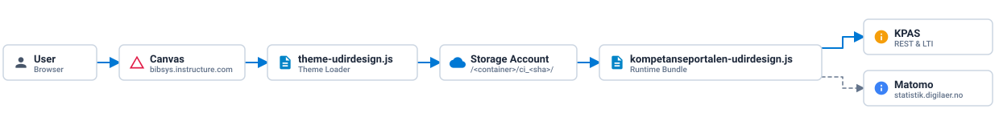

| Environment | Canvas URL | Storage Account |
| :--- | :--- | :--- |
| **Stage** | [bibsys.test.instructure.com](https://bibsys.test.instructure.com/) | [st09417311stage](https://portal.azure.com/#@udir.no/resource/subscriptions/1e210864-311c-4c1a-b27a-d022a309868f/resourceGroups/rg-kpas-stage-norwayeast-001/providers/Microsoft.Storage/storageAccounts/st09417311stage/overview) |
| **Production** | [bibsys.instructure.com](https://bibsys.instructure.com/) | [st09417311prod](https://portal.azure.com/#@udir.no/resource/subscriptions/1e210864-311c-4c1a-b27a-d022a309868f/resourceGroups/rg-kpas-prod-norwayeast-001/providers/Microsoft.Storage/storageAccounts/st09417311prod/overview) |

| Bundle | Description |
| :--- | :--- |
| `theme-udirdesign.js/.css` | Loader uploaded to Canvas Theme Editor. Resolves source and loads runtime |
| `kompetanseportalen-udirdesign.js/.css` | Main runtime bundle with components, styling, and Canvas modifications |

<details>
<summary><b>Why do I see another design load first?</b></summary>

The frontend architecture functions as a hybrid overlay on top of Canvas LMS: Canvas first renders its default native interface, and our injected JavaScript then dynamically rewrites the DOM and loads the remaining application assets. Because of this runtime DOM manipulation, users on slower internet connections or with uncached assets may experience a brief flash of the default Canvas theme before the custom theme finishes mounting.

</details>

<details>
<summary><b>Why is there a high risk of upstream Canvas updates breaking our features?</b></summary>

Because our setup relies entirely on theme injection and runtime DOM manipulation, there is a constant high risk of features breaking whenever Canvas updates:
- **Brittle DOM selectors**: Our frontend relies on JavaScript to rewrite the DOM and target specific Canvas elements. Any upstream changes to Canvas HTML markup, classes, or IDs break selectors and cause features to fail.
- **Two factor authentication (2FA)**: Enforced by Canvas for administrator accounts only, standard users do not require 2FA. This broke automated release pipelines and our Playwright test suite because logging into stage requires an admin account, standard users cannot log in there, and automated processes cannot bypass the mandatory 2FA prompt. As a result, developers must test manually, and administrators must deploy themes manually to Canvas Theme Editor.
- **Restricted JavaScript on login pages**: Canvas introduced a new security restriction disabling custom JavaScript execution on login and authentication pages to counter credential harvesting and malicious script injection attacks. Our old login page relied heavily on custom JavaScript, so this change broke existing functionality and forced a rapid migration away from custom login page scripts.
- **Host header validation for APIs**: Canvas introduced stricter host header validation on backend API endpoints. This would have broken KPAS if the service had not been patched in time.

These are some of the issues we have encountered. Keep an eye on [Canvas Release Notes](https://community.instructure.com/en/categories/canvas-release-notes) to anticipate changes and prepare migrations or patches before updates roll out to production.

</details>

## Development

To test local changes against Canvas, you can switch to the localhost theme on both stage and production to test directly in your browser without affecting other users, provided you use the cookie theme switcher instead of uploading a theme to Canvas, see instructions below in the FAQ on how to switch:

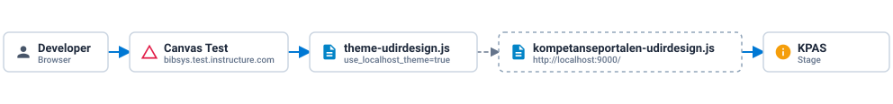

For testing all frontend components and page modifications in one place, use course `/courses/851`:
- **Stage**: [bibsys.test.instructure.com/courses/851](https://bibsys.test.instructure.com/courses/851)
- **Production**: [bibsys.instructure.com/courses/851](https://bibsys.instructure.com/courses/851)

This course contains virtually all content types, making it quick to verify the whole theme in a single course.

<details>
<summary><b>Why is stage calling production KPAS?</b></summary>

Canvas performs a monthly reset of the test environment where data and active themes are synced from production. This reset overwrites the active theme on stage with the production theme, causing stage to call production KPAS instead of staging. If you encounter unexpected behavior or loading issues on stage, verify that the correct stage theme is active under **Administrator** → **Unit Canvas** → **Tema**.

</details>

<details>
<summary><b>Which sub accounts belong to our setup?</b></summary>

Under **Administrator** → **Unit Canvas** → **Underkontoer**, there are multiple sub accounts and legacy themes from when Udir hosted Canvas for other institutions and universities. Only what is under **UDIR** belongs to our setup.

</details>

<details>
<summary><b>How do I switch Canvas to use localhost?</b></summary>

1. Navigate to **Administrator** → **Unit Canvas** → **Tema**.
2. Click the button that says **Switch to localhost theme**.
3. This sets the cookie `use_localhost_theme=true` for 15 days, instructing `theme-udirdesign.js` to load the runtime bundle from `http://localhost:9000/`. Click again to switch back.

Alternatively, run in the browser console on Canvas:
```js
document.cookie = "use_localhost_theme=true; path=/";
```

Alternatively, you can build and upload `theme-udirdesign.js/.css` directly from localhost, but this changes the loader so it attempts to load from localhost for all users. Only use the test environment at [bibsys.test.instructure.com](https://bibsys.test.instructure.com/) for this.

</details>

<details>
<summary><b>How do I test or debug as a specific user?</b></summary>

If a specific user faces issues while the theme works correctly for your account:
1. Navigate to **Administrator** → **Unit Canvas** → **Personer**.
2. Search for the person by name or email.
3. Click the mask icon next to their account to act as that user and test the application from their perspective.

</details>

<details>
<summary><b>Where do I enable new Canvas features to test them on stage?</b></summary>

If there are new Canvas features released that need to be tested on stage first, you can find and toggle them under **Administrator** → **Unit Canvas** → **Innstillinger** → **Funksjonsvalg** tab.

</details>

## Deployment

Pushing to `stage` or `main` runs GitHub Actions to build and upload the bundle to Azure Storage. An administrator then downloads the built files and uploads them into Canvas Theme Editor:

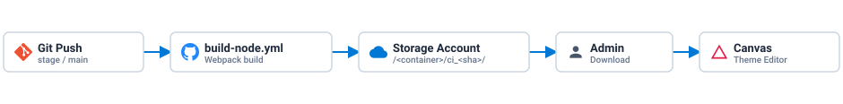

<details>
<summary><b>How do I release the Canvas theme?</b></summary>

1. Merge to `stage` or `main`. `build-node.yml` runs Webpack with `APP_VERSION=ci_<sha>` and uploads the build files in `dist/` to `<container>/ci_<sha>/` on the Azure Storage account.
2. Download the built `theme-udirdesign.js` and `theme-udirdesign.css` from the storage account.
3. Navigate to **Administrator** → **Unit Canvas** → **Tema**.
4. Click the **Tema** button → **Standardmal** to open the Theme Editor.
5. Click the **Last opp** tab.
6. Upload the downloaded files under **CSS-fil** and **JavaScript-fil**.
7. Preview the changes, save the new theme, and apply it.

</details>

<details>
<summary><b>How do I roll back a theme release?</b></summary>

Canvas preserves previously uploaded themes:
1. Navigate to **Administrator** → **Unit Canvas** → **Tema**.
2. Locate the previous working theme in the list.
3. Click **Bruk tema** to activate it immediately.

No GitHub Actions rebuild or redeployment is required.

</details>


# KPAS (backend)

KPAS is a Laravel backend providing REST endpoints and LTI 1.3 Advantage tools for Canvas LMS, managing course settings, filters, enrollments, and background sync jobs:

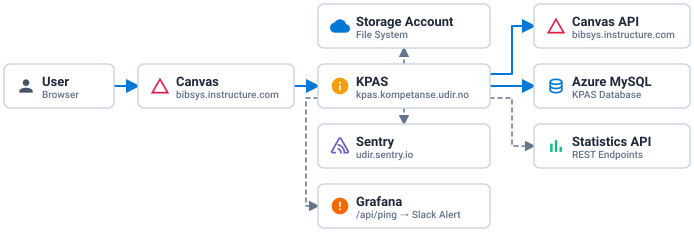

| Environment | URL | App Service | MySQL Server |
| :--- | :--- | :--- | :--- |
| **Stage** | [kpas.staging.kompetanse.udir.no](https://kpas.staging.kompetanse.udir.no/) | [kpas-staging](https://portal.azure.com/#@udir.no/resource/subscriptions/1e210864-311c-4c1a-b27a-d022a309868f/resourceGroups/Laravel/providers/Microsoft.Web/sites/kpas-staging/appServices) | [mysql-kpas-stage-norwayeast-001](https://portal.azure.com/#@udir.no/resource/subscriptions/1e210864-311c-4c1a-b27a-d022a309868f/resourceGroups/rg-kpas-stage-norwayeast-001/providers/Microsoft.DBforMySQL/flexibleServers/mysql-kpas-stage-norwayeast-001/overview) |
| **Production** | [kpas.kompetanse.udir.no](https://kpas.kompetanse.udir.no/) | [kpas-prod](https://portal.azure.com/#@udir.no/resource/subscriptions/1e210864-311c-4c1a-b27a-d022a309868f/resourceGroups/Laravel/providers/Microsoft.Web/sites/kpas-prod/appServices) | [mysql-kpas-prod-norwayeast-001](https://portal.azure.com/#@udir.no/resource/subscriptions/1e210864-311c-4c1a-b27a-d022a309868f/resourceGroups/rg-kpas-prod-norwayeast-001/providers/Microsoft.DBforMySQL/flexibleServers/mysql-kpas-prod-norwayeast-001/overview) |

<details>
<summary><b>How are the Azure resources configured?</b></summary>

Both stage and production environments, along with the Statistics API project and the shared container registry, are hosted inside the [Laravel](https://portal.azure.com/#@udir.no/resource/subscriptions/1e210864-311c-4c1a-b27a-d022a309868f/resourceGroups/Laravel/overview) resource group. Each App Service connects to a storage account using a file share, see **Configuration** → **Path mappings** in the App Service for more details.

</details>

<details>
<summary><b>Where do I monitor errors and traces for KPAS?</b></summary>

KPAS is the only service in the setup with Sentry monitoring and performance tracing enabled at [kpas-api-laravel](https://udir.sentry.io/projects/kpas-api-laravel/). It captures errors and traces across API calls and embedded LTI tool views. Because reproducing user reported issues inside Canvas and LTI tools was historically difficult, Sentry made it possible to trace root causes and eliminate most recurring issues early in the project. Always check Sentry first when investigating LTI or API endpoint issues.

For frontend LTI issues, Sentry also provides session replays with masked text and content, allowing you to see the exact user actions, impersonate the user in Canvas, and reproduce the steps to verify fixes.

</details>

<details>
<summary><b>Why are there so many alerts in Sentry, and which ones should I investigate?</b></summary>

While Sentry is essential for tracing real issues, the Canvas integration generates a large volume of false alarms and non critical errors. Many of these stem from legacy code patterns that would require extensive rewrites, which we have chosen to defer until future migrations or better filtering is implemented. Ignore isolated noise and only investigate issues when they escalate, affect multiple users, or persist over a longer period.

</details>

<details>
<summary><b>How does the /api/ping health endpoint work?</b></summary>

`GET /api/ping` in `PingController@getPing` tests connectivity to the KPAS database by querying course filters and verifies the Vimeo integration by fetching a test transcript. It returns HTTP `200` with the connection status when healthy or HTTP `500` if any check fails. Grafana polls `/api/ping` to monitor uptime and integration health and triggers a Slack alert when the endpoint reports a failure.

</details>

<details>
<summary><b>How do I access the running App Service container to view logs or run CLI commands?</b></summary>

SSH and Azure SCM are available directly through the Azure Portal on both the stage and production App Services. You can log into the container from the portal to inspect logs, debug live state, or run Artisan CLI commands.

</details>

## Cron Jobs & Sync

Supervisor runs `php artisan schedule:work` continuously inside the container, and both daily sync jobs are monitored by Sentry Crons:

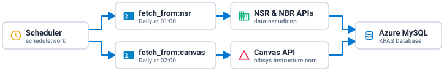

> [!WARNING]
> Avoid running sync jobs concurrently or overlapping with Statistics API pulls. Recent Canvas security measures enforce strict API rate limits even on trusted admin tokens against our own instance. Parallel or concurrent queries multiply rate limit pressure and can cause jobs to fail or take the site down.

<details>
<summary><b>php artisan fetch_from:nsr</b></summary>

- **Schedule**: Daily at `01:00` Europe/Oslo
- **Sentry monitor**: `scheduled_artisan-fetch-from-nsr` with a 45 minute max runtime
- **Description**: Pulls counties, municipalities, schools, and kindergartens from the national registries at `data-nsr.udir.no`, `data-nbr.udir.no`, and `data-nxr-fellestjeneste.udir.no`, updating the `fylkes`, `kommunes`, `skoles`, and `barnehages` tables.

</details>

<details>
<summary><b>php artisan fetch_from:canvas</b></summary>

- **Schedule**: Daily at `02:00` Europe/Oslo
- **Sentry monitor**: `scheduled_artisan-fetch-from-canvas` with a 360 minute max runtime
- **Description**: Fetches all courses and group memberships from Canvas LMS and refreshes the local mirror tables `canvas_courses` and `join_canvas_group_users`.

</details>

## LTI Tools

Canvas launches KPAS tools via LTI 1.3 Advantage. Both standard tool launches and Rich Content Editor embeds share the same 3 step OIDC and JWT handshake, store the validated Canvas claims in a Laravel session, and expose the session ID as `window.cookie` so both `4a` and `4b` can authenticate against `/api/*` endpoints protected by `LtiMiddleware`:

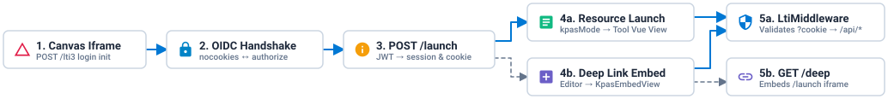

<details>
<summary><b>How do basic LTI launches and deep link embeds work step by step?</b></summary>

1. **`1. Canvas Iframe` — `POST /lti3`**: Canvas opens the tool iframe and posts the OIDC login initiation parameters `iss`, `login_hint`, `target_link_uri`, and `lti_message_hint` to `POST /lti3?config_directory=configs`.
2. **`2. OIDC Handshake` — `Lti3Middleware` and `NoCookiesView.vue`**: Because browsers block third party cookies inside iframes, `Lti3Middleware` loads `config_platform.json` via `LTI3_Database`, generates `state` and `nonce`, and renders `main.nocookies`. `NoCookiesView.vue` stores `state` and `nonce` in the parent Canvas window via `postMessage` and redirects the iframe to Canvas's `auth_login_url` at `sso.canvaslms.com/api/lti/authorize_redirect`.
3. **`3. POST /launch` — `Lti3Controller@launch`**: Canvas posts the signed `id_token` JWT to `POST /launch`. `Lti3Controller` verifies the RS256 signature against Canvas's JWKS `key_set_url`, checks that the `client_id` and `deployment_id` exist in `config_platform.json`, stores the validated custom Canvas claims in the Laravel session, injects `window.cookie = session()->getId()` into the Blade view, and branches by LTI message type:
   - **`4a. Resource Launch` — `LtiResourceLinkRequest`**: Used by course navigation tools, global profile tools, and already embedded page iframes. `Lti3Controller` reads `kpasMode` or `kpas_user_view`, fetches course group categories from the Canvas API for course views, and renders the tool's Blade and Vue view.
   - **`4b. Deep Link Embed` — `LtiDeepLinkingRequest`**: Triggered when an editor clicks the KPAS icon in the Canvas Rich Content Editor toolbar. `Lti3Controller` detects `is_deep_link_launch()`, fetches the course's Canvas modules, and renders `KpasEmbedView.vue` so the editor can pick a tool mode, diploma logos, or survey module.
   - **`5a. LtiMiddleware` — Protected `/api/*` Calls**: Because third party session cookies are blocked inside iframes, both `4a` tool views and `4b` `KpasEmbedView.vue` pass `cookie: window.cookie` when calling KPAS API endpoints such as `/api/group/*`, `/api/enrollment/*`, `/api/survey/*`, `/api/user/*`, or `/api/settings`. `LtiMiddleware` restores the Laravel session from `?cookie=<session>` and verifies that `custom_canvas_user_id` and `custom_canvas_course_id` exist in session settings before allowing the request through.
   - **`5b. GET /deep` — `DeepController@index`**: Once the editor finishes configuring the tool in `KpasEmbedView.vue`, `GET /deep` wraps the selected `/launch?config_directory=configs&kpasMode=<mode>` URL in a signed `LTI_Deep_Link_Resource` response form and auto submits it back to Canvas, which inserts the iframe into the page. When a student later views that page, the embedded iframe runs **Steps 1 → 2 → 3 → 4a → 5a**.

</details>

<details>
<summary><b>Where do I find and add LTI tools in Canvas?</b></summary>

- **Developer keys**: On `docker compose up`, `.docker/startup.sh` renders `.docker/lti_templates/*.tpl` into ready to use JSON files in `database/templates/` populated with your `APP_URL`, `CANVAS_ACCESS_KEY_NAME`, and generated JWK public key. These JSON templates are registered in Canvas under **Administrator** → **Unit Canvas** → **Utviklernøkler**.
- **Platform registration**: On initial startup, `.docker/startup.sh` also creates `database/configs/config_platform.json` locally. Each tool's client ID and deployment ID are registered in `config_platform.json` on the mounted storage account in Azure, or `database/configs/config_platform.json` locally.
- **Adding to a course**: Open the course and navigate to **Innstillinger** → **Apper** → **Vis applikasjonskonfigurasjoner** → **+ App**, choose **Av klient-ID**, paste the client ID from **Utviklernøkler**, and copy the resulting **Grupperings-ID** into the `deployment` array in `config_platform.json`.
- **Adding globally**: Follow the same process under **Administrator** → **Unit Canvas** → **Innstillinger** → **Apper**.
- **Embedding in a course page**: Edit a Canvas page, click the KPAS tool icon in the Rich Content Editor toolbar, and select the tool to embed into the page.

</details>

<details>
<summary><b>How do I troubleshoot an LTI tool issue in a course?</b></summary>

1. Inspect the embedded LTI iframe in the course using browser developer tools and verify that the course ID in the launch URL matches the actual Canvas course ID.
2. Navigate to **Administrator** → **Unit Canvas** → **Utviklernøkler** to check the developer key, match it to the LTI app registration, and verify that the tool has the right `kpasMode` configured.
3. If the issue persists, add debug log statements, ask the user to test the site again, and inspect the resulting logs, traces, and session replays in [Sentry](https://udir.sentry.io/projects/kpas-api-laravel/).

</details>

### Course & Page Tools

<details>
<summary><b>Rolle og grupper</b></summary>

- **Templates**: `database/templates/rolle_grouper.json`, `rolle_grouper_leder.json`, and `rolle_grouper_laerefag.json`
- **Launch parameter**: `kpasMode=0`
- **Canvas placement**: `course_navigation` in the left course menu and `editor_button` in the Rich Content Editor toolbar
- **Description**: Lets participants select their role and enroll into county, municipality, school, kindergarten, or faculty groups using NSR and NBR registry data. When launched via the Rich Content Editor toolbar button as an `LtiDeepLinkingRequest`, it opens `KpasEmbedView.vue`, allowing content producers to embed **Rolle og grupper**, **Undersøkelse**, **Diplom**, **Dashboard**, or **Forvaltning** iframes directly into any Canvas page.

</details>

<details>
<summary><b>Diplom</b></summary>

- **Template**: Embedded via Rich Content Editor deep linking using the **Rolle og grupper** developer key
- **Launch parameter**: `kpasMode=1` with optional `logo` query parameters
- **Canvas placement**: Embedded iframe inside a course page
- **Description**: Checks whether the current user has completed all required modules in the course and renders a downloadable PDF completion certificate with configurable partner logos.

</details>

<details>
<summary><b>Undersøkelse</b></summary>

- **Template**: Embedded via Rich Content Editor deep linking using the **Rolle og grupper** developer key
- **Launch parameter**: `kpasMode=4`
- **Canvas placement**: Embedded iframe inside a course page
- **Description**: Renders a course survey associated with a specific Canvas module, combining standard Likert scale questions with custom questions and open text essay responses.

</details>

<details>
<summary><b>Dashboard</b></summary>

- **Template**: Embedded via Rich Content Editor deep linking using the **Rolle og grupper** developer key
- **Launch parameter**: `kpasMode=3`
- **Canvas placement**: Embedded iframe inside a course page
- **Description**: Displays an aggregated visual overview of user submissions from the **Undersøkelse** tool for the course and its groups.

</details>

<details>
<summary><b>Statistikk</b></summary>

- **Template**: Embedded via Rich Content Editor deep linking using the **Rolle og grupper** developer key
- **Launch parameter**: `kpasMode=2`
- **Canvas placement**: Embedded iframe inside a course page
- **Description**: Displays course enrollment counts and group participation statistics fetched from KPAS and the Statistics API.

</details>

### Course Admin Tools

<details>
<summary><b>Forvaltning</b></summary>

- **Template**: `database/templates/forvaltning.json`, or embedded via Rich Content Editor deep linking
- **Launch parameter**: `kpasMode=5`
- **Canvas placement**: `course_navigation` in the left course menu or embedded iframe inside a course page
- **Description**: Provides content producers and course administrators with two main views: **Helsesjekk**, which runs sanity checks, universal design checks, broken link validation, and Vimeo subtitle verification across course pages, and a filterable course statistics overview.

</details>

<details>
<summary><b>Emneinnstillinger</b></summary>

- **Template**: `database/templates/emneinnstillinger.json`
- **Launch parameter**: `kpasMode=6`
- **Canvas placement**: `course_settings_sub_navigation` under Course → **Innstillinger**
- **Description**: Lets administrators configure KPAS specific course metadata used by the frontend catalogue and course banners, including category, target audience filters, course image, licence, role support, multi language support, banner alerts, unmaintained status, and the highlighted frontpage course.

</details>

### Global User Tools

<details>
<summary><b>Brukersammenslåing</b></summary>

- **Template**: `database/templates/brukersammenslaing.global.json`
- **Launch parameter**: Custom field `kpas_user_view=user_management`
- **Canvas placement**: `user_navigation` under the global Canvas user profile menu
- **Description**: Allows a user with two separate Canvas accounts to generate a one time merge token, preview overlapping course enrollments, and merge their accounts into a single user profile.

</details>

<details>
<summary><b>Brukersletting</b></summary>

- **Template**: `database/templates/brukersletting.global.json`
- **Launch parameter**: Custom field `kpas_user_view=user_deletion`
- **Canvas placement**: `user_navigation` under the global Canvas user profile menu
- **Description**: Allows users to request permanent deletion of their Canvas account, confirm the request using a verification code sent by email, or cancel a pending deletion request within the 30 day grace period.
- **CLI command**: `php artisan kpas:user_deletion` is a manual CLI command that lists and permanently deletes Canvas users who confirmed their account deletion request more than 30 days ago.

</details>

## Development

Canvas requires HTTPS for LTI 1.3 launches, so local LTI development uses ngrok to forward HTTPS traffic to your local Docker Compose stack:

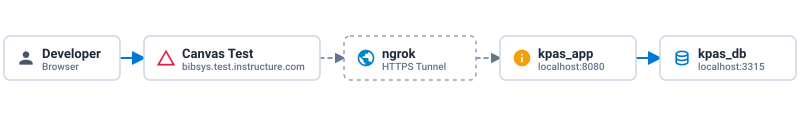

<details>
<summary><b>How do I generate a Canvas access token?</b></summary>

1. Log in to Canvas with an admin user and go to **Konto** → **Innstillinger**, or open [bibsys.test.instructure.com/profile/settings](https://bibsys.test.instructure.com/profile/settings) on stage or [bibsys.instructure.com/profile/settings](https://bibsys.instructure.com/profile/settings) on production.
2. Scroll down to **Godkjente integrasjoner** and click **+ Ny tilgangsnøkkel**.
3. Enter a description in **Formål**, set an optional expiration date, and click **Generer nøkkel**.
4. Copy the generated token immediately and set it as `CANVAS_ACCESS_KEY` in [docker-compose.yml](https://github.com/matematikk-mooc/kpas-api/blob/main/docker-compose.yml#L31) for local development, or in the Azure App Service environment variables for stage and production.

</details>

<details>
<summary><b>How do I test LTI tools locally against Canvas?</b></summary>

1. Start an ngrok tunnel forwarding HTTPS traffic to local port `8080`:
   ```bash
   ngrok http http://localhost:8080 --subdomain udir-kpas-api-<your-name>
   ```
2. Update `APP_URL`, `CANVAS_ACCESS_KEY_NAME`, and `CANVAS_ACCESS_KEY` in [docker-compose.yml](https://github.com/matematikk-mooc/kpas-api/blob/main/docker-compose.yml#L32) with your ngrok HTTPS URL and Canvas access token.
3. Start the containers, which runs `.docker/startup.sh` to generate the JWT key pair, `database/configs/config_platform.json`, and ready to use LTI developer key JSON files in `database/templates/` from your environment variables:
   ```bash
   docker compose up
   ```
4. Follow the [Setup LTI tool in Canvas LMS](https://github.com/matematikk-mooc/kpas-api#setup-lti-tool-in-canvas-lms) instructions to paste the generated JSON from `database/templates/` into Canvas under **Utviklernøkler** and add the tool to a course for local testing and debugging.

</details>

<details>
<summary><b>How do I populate the local database?</b></summary>

Populating the database via CLI triggers numerous API calls against NSR and Canvas LMS, which is slow. Whenever possible, import a database dump from stage or connect directly to the stage database by updating the `DB_` variables in `.env`.

To populate via CLI instead, run inside `kpas_app`:
```bash
php artisan migrate
php artisan fetch_from:nsr
php artisan fetch_from:canvas
```

</details>

## Deployment

Pushing to `stage` or `main` triggers GitHub Actions to build a Docker image, push it to the shared container registry located in the [Laravel](https://portal.azure.com/#@udir.no/resource/subscriptions/1e210864-311c-4c1a-b27a-d022a309868f/resourceGroups/Laravel/overview) resource group, and deploy it to Azure App Service:

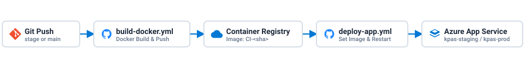

<details>
<summary><b>How do I release KPAS?</b></summary>

1. Merge to `stage` or `main`.
2. `build-docker.yml` builds the image tagged `CI-<sha>` and pushes it to the container registry in the [Laravel](https://portal.azure.com/#@udir.no/resource/subscriptions/1e210864-311c-4c1a-b27a-d022a309868f/resourceGroups/Laravel/overview) resource group.
3. `deploy-app.yml` updates the Azure App Service container configuration to `CI-<sha>` and restarts the service.

</details>

<details>
<summary><b>How do I roll back a KPAS release?</b></summary>

You can roll back to a previous image using either GitHub Actions or the Azure Portal:
1. Check the GitHub Actions run logs to identify the previous working `CI-<sha>` image tag.
2. Rerun the `deploy-app` job from that previous workflow run in GitHub Actions, or update the image tag directly in the Azure App Service settings in the Azure Portal, so the App Service pulls and runs the older image.

</details>


# Statistics API

Statistics API is a Django REST service that aggregates course, group, enrollment, module completion, page view, and visitor statistics from Canvas LMS, Matomo, KPAS, and Skoleporten CSV files, serving public JSON endpoints to KPAS:

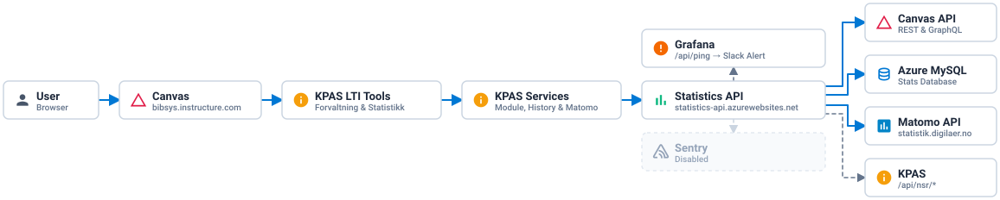

| Environment | URL | App Service | MySQL Server |
| :--- | :--- | :--- | :--- |
| **Stage** | [statistics-api-staging.azurewebsites.net](https://statistics-api-staging.azurewebsites.net/api/ping) | [statistics-api-staging](https://portal.azure.com/#@udir.no/resource/subscriptions/1e210864-311c-4c1a-b27a-d022a309868f/resourceGroups/Laravel/providers/Microsoft.Web/sites/statistics-api/slots/staging/appServices) | [mysql-kpas-stage-norwayeast-001](https://portal.azure.com/#@udir.no/resource/subscriptions/1e210864-311c-4c1a-b27a-d022a309868f/resourceGroups/rg-kpas-stage-norwayeast-001/providers/Microsoft.DBforMySQL/flexibleServers/mysql-kpas-stage-norwayeast-001/overview) |
| **Production** | [statistics-api.azurewebsites.net](https://statistics-api.azurewebsites.net/api/ping) | [statistics-api](https://portal.azure.com/#@udir.no/resource/subscriptions/1e210864-311c-4c1a-b27a-d022a309868f/resourceGroups/Laravel/providers/Microsoft.Web/sites/statistics-api/appServices) | [mysql-kpas-prod-norwayeast-001](https://portal.azure.com/#@udir.no/resource/subscriptions/1e210864-311c-4c1a-b27a-d022a309868f/resourceGroups/rg-kpas-prod-norwayeast-001/providers/Microsoft.DBforMySQL/flexibleServers/mysql-kpas-prod-norwayeast-001/overview) |

<details>
<summary><b>How is Statistics API integrated with KPAS and external services?</b></summary>

- **KPAS integration**: When a user opens **Forvaltning** or **Statistikk** inside Canvas, the Vue LTI view calls KPAS `/api/*` endpoints, which proxy requests through `ModuleService`, `HistoryService`, `MatomoService`, `GroupEnrollmentService`, and `StatisticsService` to `STATISTICS_API_URL` for module completions, user activity, page views, and group enrollment counts.
- **Data sources**: Nightly jobs pull course, group, module, and history data from Canvas REST and GraphQL APIs and visit analytics from Matomo into the stats database on Azure MySQL, while school and county endpoints query KPAS `/api/nsr/*` at request time to combine live NSR school registries with baseline teacher counts.

</details>

<details>
<summary><b>How are the Azure resources configured?</b></summary>

Statistics API is hosted inside the shared [Laravel](https://portal.azure.com/#@udir.no/resource/subscriptions/1e210864-311c-4c1a-b27a-d022a309868f/resourceGroups/Laravel/overview) resource group alongside KPAS and the container registry. Unlike KPAS, which uses two separate App Services, Statistics API runs production on the main `statistics-api` App Service and stage on its `staging` deployment slot. Both environments use the stats database on their respective Azure MySQL servers.

</details>

<details>
<summary><b>How does the container start up, and is Sentry enabled?</b></summary>

On container startup, `entrypoint.sh` starts `sshd` on port `2222` for Azure Portal SSH access and runs `start_web_app.sh` as `appuser`, which executes `python manage.py migrate`, imports the primary school and county teacher count CSV files from `statistics_api/data/`, and starts Gunicorn on port `8000`.

Although the Sentry SDK is wired up in `statistics_api/settings.py`, Sentry monitoring is currently disabled for Statistics API, as KPAS is the only service in the setup actively reporting to Sentry.

</details>

<details>
<summary><b>How does the /api/ping health endpoint work?</b></summary>

`GET /api/ping` in `statistics_api/ping/views.py` verifies connectivity across the stats database, the Canvas REST API, and the Matomo API, returning HTTP `200` with `GIT_COMMIT` and integration status when all three succeed or HTTP `500` if any check fails. Grafana polls `/api/ping` to monitor service and integration health and sends a Slack alert when a check fails.

</details>

<details>
<summary><b>How do I access the running App Service container to view logs or run CLI commands?</b></summary>

SSH and Azure SCM are available directly through the Azure Portal on both the `statistics-api` production App Service and the `staging` deployment slot. You can log into the container from the portal to inspect logs or run `python manage.py` CLI commands.

</details>

## Cron Jobs & Sync

An in process `APScheduler` background scheduler starts inside `statistics_api/apps.py` and triggers `python manage.py do_all_scheduled_maintenance_jobs` daily at `03:00` UTC, which runs seven data collection commands sequentially:

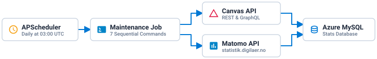

> [!WARNING]
> Avoid running maintenance commands concurrently or overlapping with KPAS sync jobs. Recent Canvas security measures enforce strict API rate limits even on trusted admin tokens against our own instance. Parallel or concurrent queries multiply rate limit pressure and can cause data pipelines to fail or take the site down.

<details>
<summary><b>python manage.py do_all_scheduled_maintenance_jobs</b></summary>

- **Schedule**: Daily at `03:00` UTC via `APScheduler`, configurable through `DATABASE_REFRESH_HOUR` and `DATABASE_REFRESH_MINUTE`
- **Description**: Orchestrator command that runs the seven data pull commands below in sequence. It only catches `JSONDecodeError` and `AssertionError` between commands, so any other unhandled exception aborts the remaining commands in the nightly chain.
- **Sequential commands**:
  1. **`pull_total_students_counts_from_courses`**: Queries the Canvas REST API for all courses under `CANVAS_ACCOUNT_ID` and stores total student counts in `total_students`.
  2. **`pull_course_member_counts_from_canvas`**: Queries the Canvas REST API for courses, group categories, and group member counts, parses school organization numbers from group descriptions, flags groups with fewer than 5 members as `aggregated`, and inserts records into `course_observation`, `group_category`, and `group`.
  3. **`fetch_course_enrollment_activity`**: Queries the Canvas GraphQL API for each course and counts enrolled users active in the last 24 hours into `enrollment_activity`.
  4. **`pull_data_from_matomo`**: Queries the Matomo API at `statistik.digilaer.no` using `MATOMO_ACCESS_KEY` for yesterday's site wide visit metrics and per URL page statistics into `visits` and `page_statistics`.
  5. **`pull_finnish_marks_canvas`**: Queries the Canvas REST API across two worker threads for published modules and students active yesterday, recording module item completions per student and group in `module`, `module_item`, `finnished_student`, and `finnish_mark_count`.
  6. **`pull_history_from_canvas_and_update_db`**: Queries the Canvas REST API for every user across all Canvas accounts and stores yesterday's page view events in `history`.
  7. **`pull_course_group_registrations`**: Queries the Canvas GraphQL API for new course and group memberships created yesterday and writes daily totals to `daily_registrations`.

</details>

<details>
<summary><b>python manage.py import_school_teacher_counts_from_csv & import_county_teacher_counts_from_csv</b></summary>

- **Schedule**: Executed automatically on container startup via `start_web_app.sh`
- **Description**: Imports primary school teacher counts per organization number and high school teacher counts per county from tab separated Skoleporten CSV files in `statistics_api/data/` into the `school` and `county` tables. These baseline numbers are combined with live NSR registry lookups against KPAS `/api/nsr` when calculating municipal and county participation percentages.

</details>

## Development

Statistics API runs locally via Docker Compose with a Django development server on port `8000` and a local MySQL 8.4 database on port `3310`:

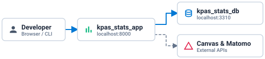

<details>
<summary><b>How do I run Statistics API locally?</b></summary>

1. Set a valid `CANVAS_ACCESS_KEY` and optional `MATOMO_ACCESS_KEY` in [docker-compose.yml](https://github.com/matematikk-mooc/statistics-api/blob/master/docker-compose.yml#L29).
2. Start the containers, which runs `.docker/startup.sh` to copy `.docker/.env.template` to `.env`, install Python dependencies from `requirements.txt`, run `python manage.py migrate`, and start `python manage.py runserver 0.0.0.0:8000`:
   ```bash
   docker compose up
   ```
3. Verify the local service at `http://localhost:8000/api/ping` or `http://localhost:8000/version`.

</details>

<details>
<summary><b>How do I populate the local database?</b></summary>

Running the full maintenance job locally triggers thousands of API requests against Canvas LMS and Matomo, which is slow. Whenever possible, import a database dump from stage or connect directly to the stage database by updating the `DB_` variables in `.env`.

To populate specific tables via CLI instead, run the individual management commands inside `kpas_stats_app`:
```bash
python manage.py import_school_teacher_counts_from_csv
python manage.py import_county_teacher_counts_from_csv
python manage.py pull_total_students_counts_from_courses
python manage.py pull_course_member_counts_from_canvas
```

</details>

<details>
<summary><b>How do I update the yearly teacher count CSV files?</b></summary>

1. Open [Skoleporten Rapportbygger](https://statistikkportalen.udir.no/rapportbygger/) for Grunnskole or Videregående opplæring and export the latest teacher count tables as tab separated `.csv` files encoded in `UTF-8` without BOM, following the step by step instructions in the [Statistics API README](https://github.com/matematikk-mooc/statistics-api#updating-csv-files-yearly).
2. Save the files in `statistics_api/data/` as `primary_schools_data_<year>.csv` and `county_data_<year>.csv`, where `<year>` is the four digit starting year of the school year.
3. Commit and deploy the new files so `start_web_app.sh` imports them automatically on container startup.

</details>

## Deployment

Pushing to `stage` or `master` triggers `.github/workflows/tests.yml` to run the Django test suite against a test MySQL container, build and push the Docker image to the container registry in the [Laravel](https://portal.azure.com/#@udir.no/resource/subscriptions/1e210864-311c-4c1a-b27a-d022a309868f/resourceGroups/Laravel/overview) resource group, and update the Azure App Service:

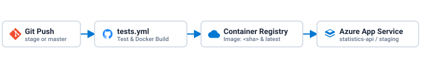

<details>
<summary><b>How do I release Statistics API?</b></summary>

1. Merge to `stage` or `master`.
2. `tests.yml` runs migrations, `python3 manage.py test`, and `python3 manage.py check --deploy` against a temporary MySQL 8.0 service container.
3. On passing tests, `tests.yml` builds the Docker image tagged with both `:<sha>` and `:latest`, sets `GIT_COMMIT=<sha>` on the target Azure App Service or `staging` slot via Azure CLI, and pushes the image to the container registry in the [Laravel](https://portal.azure.com/#@udir.no/resource/subscriptions/1e210864-311c-4c1a-b27a-d022a309868f/resourceGroups/Laravel/overview) resource group.

</details>

<details>
<summary><b>How do I roll back a Statistics API release?</b></summary>

1. Check the GitHub Actions run logs or the container registry in the Azure Portal to find the previous working `<sha>` image tag.
2. Update the container image tag and `GIT_COMMIT` setting on the `statistics-api` App Service or its `staging` deployment slot in the Azure Portal to pull and run the older `<sha>` image instead of `:latest`.

</details>


# Grafana

Grafana in [Utdanningsdirektoratet/dit-data-grafana](https://github.com/Utdanningsdirektoratet/dit-data-grafana/tree/stage) is a multi service monitoring and alerting stack that tracks service availability, integration health, SSL certificate expiry, Playwright test runs, expiration reminders, and KPAS user deletion queues, displaying live dashboards on the Udir office TV kiosk and sending alerts to Slack:

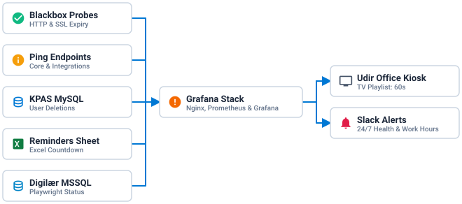

| Environment | URL | Resource Group |
| :--- | :--- | :--- |
| **Stage** | [app-ditlogs-stage-norwayeast-001.azurewebsites.net](https://app-ditlogs-stage-norwayeast-001.azurewebsites.net/) | [rg-ditlogs-stage-norwayeast-001](https://portal.azure.com/#@udir.no/resource/subscriptions/1e210864-311c-4c1a-b27a-d022a309868f/resourceGroups/rg-ditlogs-stage-norwayeast-001/overview) |

<details>
<summary><b>Why is there only a stage environment?</b></summary>

Grafana is hosted as a single shared instance in [rg-ditlogs-stage-norwayeast-001](https://portal.azure.com/#@udir.no/resource/subscriptions/1e210864-311c-4c1a-b27a-d022a309868f/resourceGroups/rg-ditlogs-stage-norwayeast-001/overview) with no separate production App Service. Only the `stage` branch in [Utdanningsdirektoratet/dit-data-grafana](https://github.com/Utdanningsdirektoratet/dit-data-grafana/tree/stage) is actively used to build and deploy the container, and this single instance monitors production services across Udir.

</details>

<details>
<summary><b>How is the Grafana container structured?</b></summary>

A single Alpine Docker container runs `supervisord` to manage the internal services behind Nginx on port `80` and `sshd` on port `2222`:
- **Nginx on `:80`**: Reverse proxies requests to Grafana and the internal monitoring services.
- **Grafana on `:3000`**: Runs Grafana backed by PostgreSQL on `DB_HOST` with `DB_NAME=grafana`, preinstalled with the Infinity JSON datasource plugin `yesoreyeram-infinity-datasource`, the GitHub datasource plugin `grafana-github-datasource`, and the custom GeoJSON map plugin `1262706-geojson-panel`.
- **Prometheus on `:9090` & Blackbox Exporter on `:9115`**: Scrapes `http_2xx` probes every `1m` with a `15s` evaluation interval against production and internal container health endpoints.

</details>

<details>
<summary><b>How do I log into Grafana?</b></summary>

- **Admin login**: Direct admin credentials are stored in 1Password under `(Stage) DIT Logs - Grafana`.
- **Azure AD login**: Users can sign in with Azure AD via the [DIT - Grafana](https://portal.azure.com/#view/Microsoft_AAD_RegisteredApps/ApplicationMenuBlade/~/Overview/appId/7b2de9d5-bce0-43c6-9ac4-46316d5f3925/isMSAApp~/false) App Registration.

</details>

<details>
<summary><b>How do I manage user roles in Grafana?</b></summary>

User and group roles are assigned in the [DIT - Grafana Enterprise Application](https://portal.azure.com/#view/Microsoft_AAD_IAM/ManagedAppMenuBlade/~/Overview/objectId/ff287f9d-40fd-4731-b8c0-d6917d5b2783/appId/7b2de9d5-bce0-43c6-9ac4-46316d5f3925) using three app roles:
- **Grafana Admin** with value `Admin` for Grafana admin users.
- **Grafana Editor** with value `Editor` for Grafana editor users.
- **Grafana Viewer** with value `Viewer` for Grafana read only users.

</details>

## Dashboards & Kiosk Playlist

The Udir office TV screen runs the **DIT - Kiosk Tromsø** playlist on a `60s` rotation interval, cycling through four dashboards in the `(Offentlig) DIT - Avdeling for digitale tjenester` folder:

<details>
<summary><b>Helsesjekk</b></summary>

Displays the **HTTP Probe Overview** table with `Status`, `Code`, `SSL`, `TLS Version`, `SSL Cert Expiry (days)`, `Probe Duration (s)`, and `DNS Lookup Duration (s)`, alongside **HTTP Status Timeline** and **HTTP Probe Duration** across 12 monitored endpoints and shared integrations:
- **Kompetanseportalen**: `https://bibsys.instructure.com/`
- **KPAS API**: `https://kpas.kompetanse.udir.no/api/ping`
- **Statistikk API**: `https://statistics-api.azurewebsites.net/api/ping`
- **Kursportalen**: `https://kurs.udir.no/api/ping.php`
- **Digilær & Digilær Skole**: `https://digilaer.no/` and `https://skole.digilaer.no/login/index.php`
- **DuBestemmer**: `https://www.dubestemmer.no/`
- **Shared integrations**: **Feide** at `https://www.feide.no/`, **Vimeo** at `https://vimeo.com/api/oembed.json`, **H5P** at `https://udir.h5p.com/ping`, **GeoGebra** at `https://www.geogebra.org/`, and **Trinket** at `https://trinket.io/`

</details>

<details>
<summary><b>Playwright Status</b></summary>

Queries the `ditmon` MSSQL database to display automated end to end browser test results for Digilær under `DIGILÆR PLAYWRIGHT STATUS`, including today's test runs in `Dagens tester`, test breakdowns by operating system across `Github-runner`, `Windows`, and `OS X`, breakdowns by browser across `Chrome` and `Edge`, active devices by browser version, and a 30 day pass and fail history across `OK`, `Feilet`, and `Uavklart`.

</details>

<details>
<summary><b>Påminnelser</b></summary>

Displays expiration countdown tables with `Utløpsdato`, `Tittel`, and `Utløper (dager)` for **KURSP - Kompetanseportalen**, **DVMTEK - Digilær**, and **KURS - Kursportalen** to track upcoming renewals such as Maskinporten JWK tokens, mail mappings, and scheduled maintenance tasks. Staff enter and update items directly in a shared Excel spreadsheet linked at the top of the dashboard, and Grafana fetches the parsed rows via the Infinity datasource.

</details>

<details>
<summary><b>KOMP – Brukersletting</b></summary>

Queries the `user_deletion_tokens` table in the KPAS MySQL database `db_kpas` to track Canvas user account deletion requests:
- **Status counters**: Shows live totals for `Bekreftet`, `Klar for sletting`, `Slettet`, `Opprettet (ubekreftet)`, `Avbrutt`, and `Totalt`.
- **Quarantine & ready queues**: Lists users in `Klar for sletting (30+ dager)` who have completed the 30 day quarantine period alongside users still counting down in `Venteperiode (nedtelling til 30 dager)` and a timeline of requests over time.

</details>

## Alerting & Slack Notifications

Grafana evaluates alert rules every `1m` under `(Offentlig) DIT - Avdeling for digitale tjenester` and routes notifications to Slack:

<details>
<summary><b>How do health alerts and basic vs. advanced /api/ping checks work?</b></summary>

Health rules `KOMP - Health`, `KURS - Health`, `DUB - Health`, and `DIGI - Health` run 24/7 without mute timings and support two levels of failure reporting in Slack:
- **Basic overview**: Standard Prometheus Blackbox HTTP probes against `bibsys.instructure.com`, `kpas.kompetanse.udir.no/api/ping`, `statistics-api.azurewebsites.net/api/ping`, `digilaer.no`, `skole.digilaer.no`, and `www.dubestemmer.no` report whether the endpoint is reachable as `UP` or `DOWN` based on HTTP `200` status.
- **Advanced `/api/ping` overview**: Services queried with the Infinity JSON datasource such as Moodle Kursportalen at `https://kurs.udir.no/api/ping.php` return structured status for `core` dependencies and external `integrations`:
  ```json
  {
    "error": false,
    "statusCode": 200,
    "severity": "ok",
    "state": "ready",
    "redirect": null,
    "messages": [],
    "payload": {
      "core": {
        "storage": true,
        "database": true
      },
      "integrations": {
        "email": true,
        "cron": true,
        "task_failures": true,
        "task_queue": true,
        "task_long_running": true,
        "oauth2_feide": true,
        "oauth2_microsoft": true,
        "oauth2_idporten": true,
        "core_router": true,
        "theme_boost_union_recommendations": true
      }
    }
  }
  ```
  Instead of only reporting a site as up or down in Slack, Grafana inspects `core` and `integrations` to report whether the service is **degraded** when an integration fails or **down** when a core dependency fails, listing the exact failing keys in the Slack message so you can immediately see which underlying dependency is affecting one or more sites.

</details>

<details>
<summary><b>How do I disable basic health alerts during maintenance?</b></summary>

Advanced `/api/ping.php` endpoints can report maintenance state directly in their JSON payload, whereas basic Prometheus Blackbox probes fire an alert as soon as the site stops returning HTTP `200`. Before starting planned maintenance on a site with a basic health check, open **Alerting** → **Alert rules** in Grafana, expand `(Offentlig) DIT - Avdeling for digitale tjenester`, click **Edit** or **More** → **Pause evaluation** on the target `Health` rule, or create a temporary silence under **Alerting** → **Silences**, and resume evaluation once maintenance is complete.

</details>

<details>
<summary><b>How do SSL certificate expiry alerts work?</b></summary>

Four Prometheus alert rules `KOMP - SSL Expiry`, `DIGI - SSL Expiry`, `KURS - SSL Expiry`, and `DUB - SSL Expiry` monitor `probe_ssl_earliest_cert_expiry` from Blackbox Exporter and send a Slack alert when a domain's remaining SSL certificate validity drops below the configured day threshold.

</details>

<details>
<summary><b>How do the 14 day reminder alerts work?</b></summary>

Three Infinity datasource alert rules `KOMP - Reminders (14d)`, `KURS - Reminders (14d)`, and `DIGI - Reminders (14d)` check the Excel reminders feed and send a Slack notification when any tracked item has 14 or fewer days remaining until expiration.

</details>

<details>
<summary><b>How do KOMP user deletion alerts work?</b></summary>

`KOMP - User Deletion` queries the KPAS MySQL database and sends a Slack alert when a confirmed user deletion request finishes its 30 day quarantine period and is waiting for an administrator to manually run `php artisan kpas:user_deletion`.

</details>

<details>
<summary><b>How do mute timings work for work hours vs. 24/7 alerts?</b></summary>

Only the service health alerts fire 24/7. All other alert rules for `Reminders`, `SSL Expiry`, and `User Deletion` attach two mute timings so notifications are only sent during work hours from `06:00` to `13:00` UTC, Monday through Friday:
- **`mute-non-work-days`**: Mutes alerts all day on `Sat` and `Sun`.
- **`mute-non-work-hours`**: Mutes alerts every day from `00:00` to `06:00` UTC and from `13:00` to `24:00` UTC.

</details>

## Deployment

Pushing to the `stage` branch triggers `.github/workflows/branch-stage-v1.yml`, which builds and pushes the Docker image and updates `app-ditlogs-stage-norwayeast-001` in [rg-ditlogs-stage-norwayeast-001](https://portal.azure.com/#@udir.no/resource/subscriptions/1e210864-311c-4c1a-b27a-d022a309868f/resourceGroups/rg-ditlogs-stage-norwayeast-001/overview):

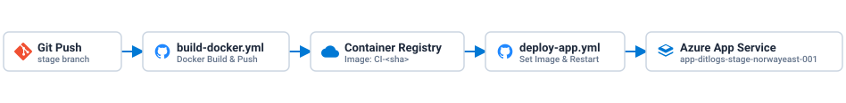

<details>
<summary><b>How do I release Grafana?</b></summary>

1. Push or merge changes to the `stage` branch rather than `main`.
2. `branch-stage-v1.yml` runs `build-docker.yml` to build the Docker image and push it tagged as `CI-<sha>` to the container registry.
3. Once the image build succeeds, `deploy-app.yml` sets the new `CI-<sha>` image on `app-ditlogs-stage-norwayeast-001` in [rg-ditlogs-stage-norwayeast-001](https://portal.azure.com/#@udir.no/resource/subscriptions/1e210864-311c-4c1a-b27a-d022a309868f/resourceGroups/rg-ditlogs-stage-norwayeast-001/overview) and restarts the App Service.

</details>

<details>
<summary><b>How do I roll back a Grafana release?</b></summary>

1. Check the GitHub Actions run logs to identify the previous working `CI-<sha>` image tag.
2. Rerun the `deploy-app` job from that previous workflow run in GitHub Actions, or update the container image tag directly on `app-ditlogs-stage-norwayeast-001` in the Azure Portal so the App Service pulls and runs the older image.

</details>
